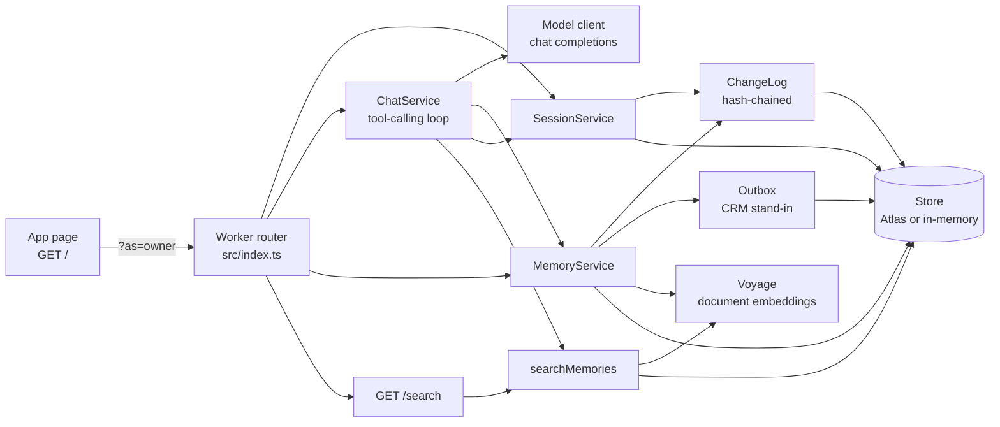
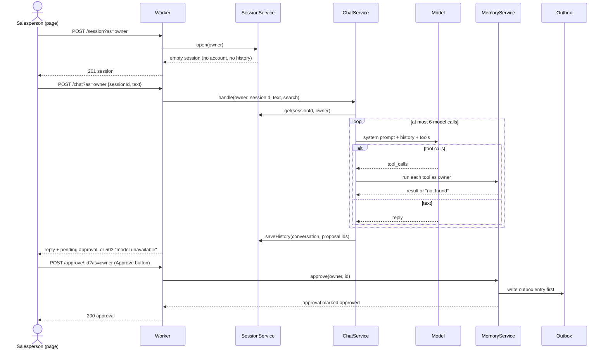
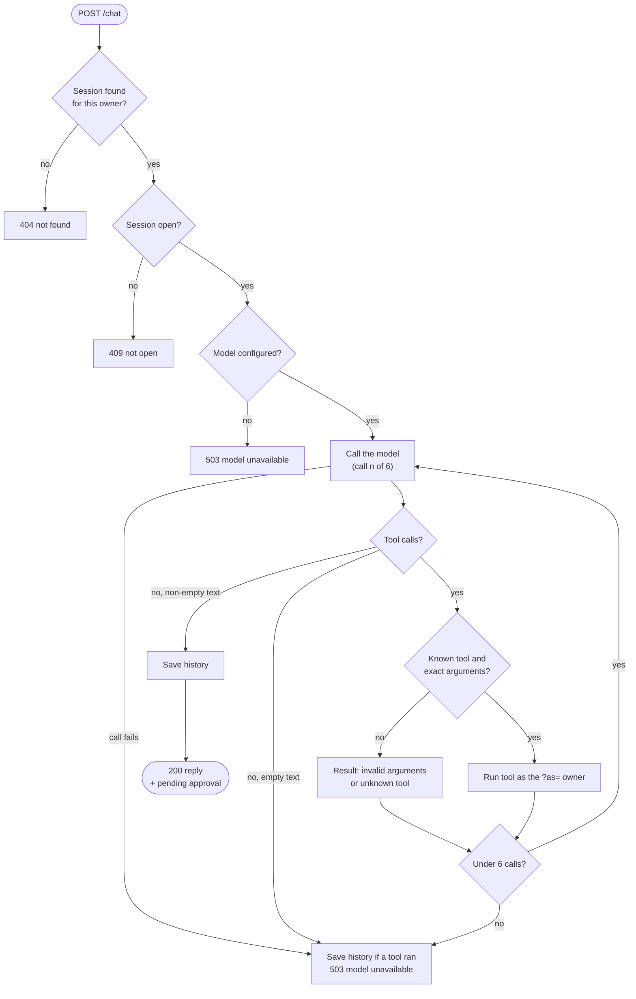
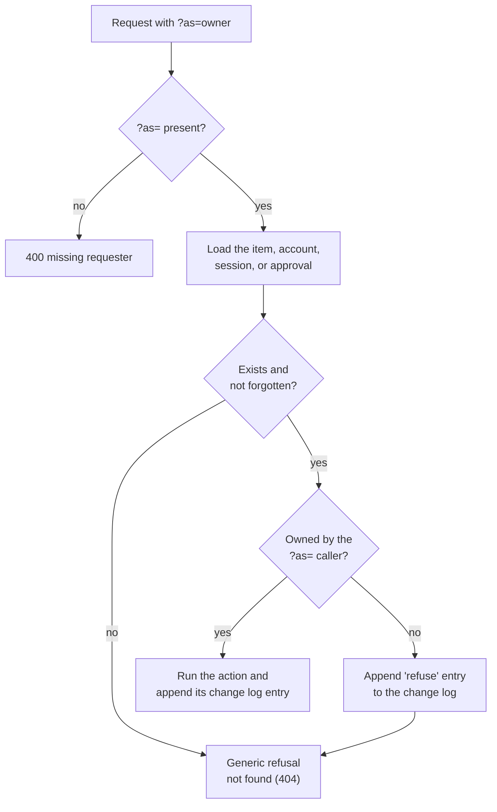
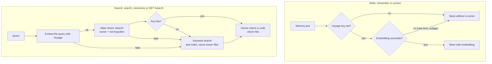
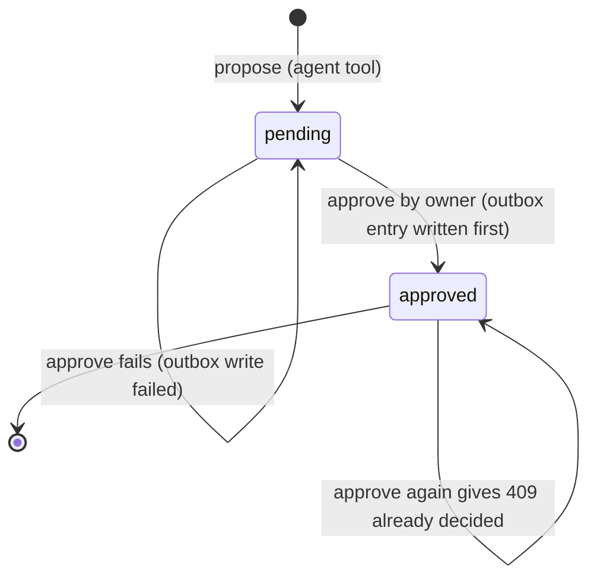
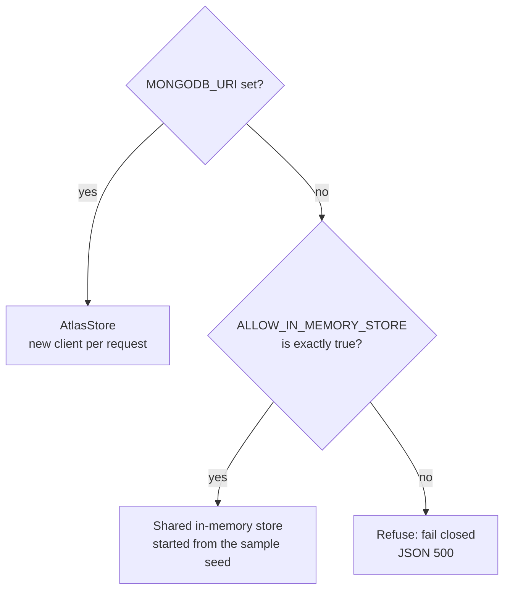

# Architecture

Everything runs in one Cloudflare Worker (`src/index.ts`). Each request picks
its store from the environment (`src/factory.ts`), builds the governed
services over it, and closes any database client when the request finishes.

## Request flow

A salesperson opens a blank session, then chats. Each chat turn sends the saved
conversation plus the new message to the model, with the tool definitions. The
model replies with text or with tool calls. Each tool call is run as the
`?as=` owner and its result is fed back, for at most **6 model calls** per turn
(`MAX_MODEL_CALLS`). Approval is a separate human request.

### The tool-calling loop

### The governed tools

| Tool | Arguments | What it does |
| --- | --- | --- |
| `list_my_accounts` | none | The owner's own client accounts (id, name, status) |
| `list_products` | none | Products with their sample price wording, read-only |
| `search_memories` | `query` | Up to 5 of the owner's memories, by meaning |
| `remember` | `account_id`, `text`, `kind` | Saves a memory on one of the owner's accounts |
| `correct` | `item_id`, `text` | Replaces a memory's text; the old text stays in its history |
| `forget` | `item_id` | Replaces a memory's content with a tombstone |
| `propose` | `account_id`, `summary` | Stores a pending approval; nothing changes until a human approves |

No tool takes an owner argument, and a call with any extra argument key is
rejected as `invalid arguments` before it runs. There is no approve tool.

## Owner scoping

The owner is always the `?as=` caller. Every check that fails answers with the
same generic refusal, so a missing item and someone else's item look the same.
Cross-owner attempts are logged.

Search applies the same rule twice. The database query filters on
`owner_salesperson_id` and `forgotten: false`, and every returned hit is checked
against the owner again in code. The chat's `search_memories` tool filters the
hits a third time before handing them to the model.

## Embed on write, search with a fallback

`remember` and `correct` embed the memory text with Voyage (`voyage-3`, 1024
dimensions) when the Voyage key is set. Embedding fails soft: if it fails, the
memory is stored without a vector rather than not at all. Search tries the
vector path first and falls back to keywords.

In local development, with no database, the chat's search is a simple keyword
match over the in-memory store instead.

## Approval and the outbox

## Choosing the store

